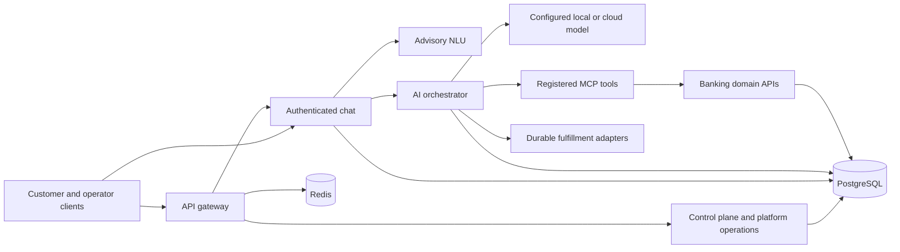

# Customer Servicing Platform

A dedicated enterprise servicing platform with a banking accelerator, built around
the existing Node.js services, React clients, LangGraph orchestration and MCP tools.
Digital chat, AVA and provider-neutral IVR share governed intents, prompts, policy,
fulfillment and release configuration.

[Quick start](docs/getting-started/quick-start.md) ·
[Documentation index](docs/README.md) ·
[Deployment](docs/guides/deployment.md) ·
[Platform operations](docs/guides/platform-readiness.md)

## Product capabilities

- **Servicing Studio** at `/control-plane`: author every canonical intent and
  prompt, typed custom intents, recognition policy, journeys, channels, queues,
  knowledge and model profiles across 17 workspaces.
- **Procedures and guardrails**: import SOP documents into release-governed
  procedures the assistant follows. Typed guardrails (required details,
  confirmation, specialist handoff, prohibited wording, required disclosures) are
  enforced in code, and customer procedures ground answers with citations.
- **Governed changes**: immutable releases, semantic diffs, exact-content contract
  evaluations, independent approval, environment promotion, canaries and rollback.
  Active confirmation flows retain their pinned configuration.
- **Measured response quality**: synthetic model probes, objective assertions,
  recorded-run comparison and exact-content model evaluation gates.
- **Agent workspace**: connector case assignment, safe context, approved knowledge
  citations and revision-protected handling/disposition.
- **Durable conversation recovery**: PostgreSQL graph checkpoints and an explicit
  owner-authorized resume action, retaining the original release and effect ledger.
- **Reusable solutions**: catalog, configuration import/export, conflict-aware
  preview and reviewed draft application. Packages retain all release gates and
  cannot install arbitrary code, endpoints or credentials.
- **Provider portability**: Qwen/Ollama on a separate Mac Studio, OpenAI Responses,
  compatible servers, Vertex Gemini and Gemini API plugins. Model routing and
  prompts are versioned; credentials and trusted endpoints stay server-side.
- **Recoverable fulfillment**: cases, leased jobs, idempotent adapter operations,
  signed callbacks, SLA escalation, reconciliation and operational exceptions for
  unknown financial outcomes.
- **Enterprise operation**: OIDC/PKCE and signed local roles, tenant enforcement,
  internal service authentication, shared Redis rate limits, durable PostgreSQL
  records, explicit migrations, readiness diagnostics and evidence export.

The supported product target is a **dedicated enterprise deployment** with
provider-neutral adapters. Live telephony/media, enterprise identity and connector
qualification require configured providers. Shared SaaS tenancy, commercial
entitlements and a certified production SLA are outside the delivered scope.
See the [implementation record](docs/guides/servicing-product-implementation.md)
and [current platform gap assessment](docs/guides/platform-gap-assessment.md).

## Architecture



Tool-backed banking decisions retain code-owned authorization, typed data,
confirmation and tool contracts. Model-assisted recognition, extraction and
no-tool generation are optional and do not guarantee identical model outputs.
See [deterministic boundaries](docs/architecture/determinism.md).

| Service | Development port | Responsibility |
| --- | ---: | --- |
| `frontend` | 3000 | Customer application and Servicing Studio |
| `api-gateway` | 3001 | External APIs, control plane, identity, platform and operations |
| `nlu-service` | 3003 | Advisory recognition integration |
| `mcp-service` | 3004 | Registered domain tools |
| `banking-service` | 3005 | Customer authentication and banking operations |
| `chat-backend` | 3006 | Authenticated chat and persisted sessions |
| `ai-orchestrator` | 3007 | Policy, workflow, model plugins and effect ledger |
| `agent-ui` | 8081 | Support agent dashboard |

The root workspaces and canonical deployment use `services/*`. `packages/*` and
`docker-compose-enterprise.yml` are legacy/experimental. The production overlay
keeps internal services private and publishes only loopback frontend/gateway
ports for a customer-managed TLS ingress.

## Run locally

Use Node.js 22, npm 10+, PostgreSQL 15, Redis 7 and Docker Compose. Host execution
also needs PostgreSQL client tools. Preserve an existing development environment:

```bash
test -f .env.development || cp .env.example .env.development
npm ci
./scripts/run-with-env.sh docker compose -f docker/docker-compose.local.yml up -d postgres redis
./scripts/run-with-env.sh npm run db:setup
./scripts/run-with-env.sh npm run db:seed
npm run dev
```

This starts all eight services. Open http://localhost:3000 and run `npm run health`.
The [quick start](docs/getting-started/quick-start.md) covers the Docker alternative,
demo-only login and operator privileges. Start infrastructure first and wait for
PostgreSQL before database setup. Do not run host and Docker applications on the
same ports simultaneously.

Environment files are parsed as dotenv **data** through `scripts/run-with-env.sh`;
there is no shell execution or `${VARIABLE}` interpolation. `APP_ENV_FILE` selects
another file. Never put credentials in public frontend runtime configuration.

## Operate and extend

| Task | Entry point |
| --- | --- |
| Configure Qwen on the separate Mac Studio | [Model setup](docs/guides/llm-providers.md) |
| Evaluate real model responses and gate releases | [Response quality](docs/guides/model-evaluation.md) |
| Review current market gaps and differentiation | [Platform assessment](docs/guides/platform-gap-assessment.md) |
| Edit prompts/intents and govern releases | [Control-plane guide](docs/guides/control-plane.md) |
| Import SOPs the assistant follows, with enforced guardrails | [Procedures and guardrails](docs/guides/procedures-and-guardrails.md) |
| Diagnose readiness and install a solution draft | [Platform guide](docs/guides/platform-readiness.md) |
| Configure voice, cases, knowledge and identity | [Operations runbook](docs/guides/servicing-operations.md) |
| Bootstrap the first operator safely | [Administrator bootstrap](docs/guides/platform-readiness.md#bootstrap-the-first-administrator) |
| Prepare production infrastructure and migrations | [Deployment guide](docs/guides/deployment.md) |
| Understand APIs and internal boundaries | [API index](docs/api/README.md) |
| Review implementation and remaining qualification | [Implementation record](docs/guides/servicing-product-implementation.md) |

A standard Ollama example uses `http://mac-studio.local:11434`; LM Studio commonly
uses port 1234 and compatible servers can use 8000. Replace the hostname/model tag
with the actual Studio settings. No remote model has been verified from this
MacBook. `npm run llm:probe -- --list` inspects configuration without inference;
explicit discovery/test options contact the configured provider.

For production, complete a protected copy of [`.env.production.example`](.env.production.example),
provide public runtime JSON and private secret/registry mounts, then follow the
migration and startup sequence in the deployment guide. `production:preflight`
validates static configuration; authenticated platform diagnostics check runtime
services/storage. Neither substitutes for a customer pilot, load testing or a
backup/restore rehearsal.

## Verify changes

```bash
npm test
npm run test:deployment
npm run build:frontend
npm run lint
npm run product:validate
```

PostgreSQL reliability tests require their explicit disposable test URLs; see
[Development](docs/guides/development.md). Some legacy integration shell scripts
are environment-dependent and are not acceptance evidence on their own.
Historical completion reports are classified in the [documentation index](docs/README.md).

The root package declares the MIT license.
