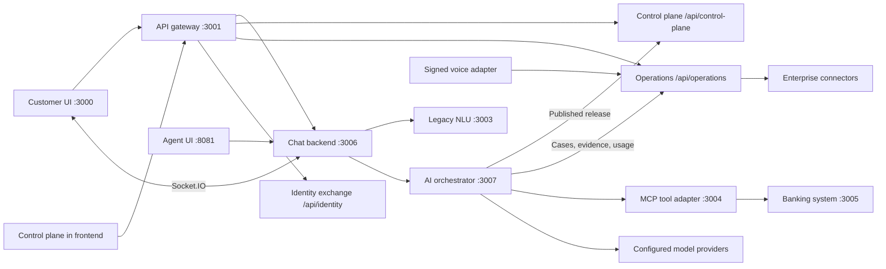

# Architecture overview

This repository implements a dedicated-enterprise customer-servicing platform with a banking reference domain. Digital chat, AVA, and IVR share published journey policy, authenticated workflow execution, human fulfillment, and operational evidence. This page describes the current source architecture; it is not a deployment certification.

## Runtime boundaries

Browser REST requests use the gateway. Socket.IO connects to the chat backend at `/socket.io`. The gateway hosts the control plane, enterprise identity exchange, and operations APIs; these are modules of the gateway, not additional standalone services. The separate agent UI is an Express/static client, not the React control-plane console.

| Service | Default port | Responsibility |
| --- | --- | --- |
| Frontend | 3000 | React/Vite customer UI and governed control-plane console |
| API gateway | 3001 | Routing, access controls, control plane, identity, operations |
| NLU | 3003 | Legacy canonical intent classification and compatibility NLP endpoints |
| MCP | 3004 | Declared banking tools over HTTP and repository JSON-RPC WebSocket transport |
| Banking | 3005 | Customer/account authorization and authoritative domain operations |
| Chat backend | 3006 | REST/Socket.IO sessions, pending feedback, channel handoff |
| AI orchestrator | 3007 | Published policy, recognition, field validation, confirmation, execution ledger |
| Agent UI | 8081 | Operator conversation interface |

Ports are deployment defaults. NLU and MCP read `NLU_SERVICE_PORT` and `MCP_SERVICE_PORT`; the other Node entry points generally read `PORT`. See the supported [configuration guide](../getting-started/configuration.md), [service index](../../services/README.md), and root Compose files rather than historical per-service startup instructions.

## A servicing turn

1. A verified access token and deployment tenant identify the customer. Chat verifies ownership before accepting session messages.
2. Pending data collection or confirmation goes directly to orchestrator feedback. A new request may obtain a legacy NLU hint, but enabled control-plane recognition is authoritative.
3. The orchestrator fetches the selected published environment/cohort, recognizes a configured intent, and pins the full release snapshot before executing the workflow. Unknown or ambiguous requests clarify or route to human support.
4. Channel, intent, journey, field, tool, and confirmation rules run within the established LangGraph workflow. The domain service remains the final authority for banking access and business validation.
5. Approved mutations use a durable operation key. Acknowledged results can be replayed without resubmitting; an uncertain outcome requires reconciliation.
6. Tool-backed banking replies are formatted from authoritative results. Generic service requests create durable cases; knowledge answers use approved source content and citations. Model generation is limited to its configured text/JSON tasks.
7. Cases, operational events, and actual usage measurements are sent to the gateway operations service with both user and servicing-service credentials.

## Configuration and provider ownership

The control plane owns drafts, immutable releases, evaluation suites, knowledge publications, environment rollout policy, journeys, queues, intent settings, and model profiles. Runtime reads published configuration; drafts do not affect execution. Existing workflows retain their release through feedback and handoff.

Endpoint URLs, credentials, connector registries, and model-provider registrations are server-owned. A published model profile selects a registered provider and model; it cannot add a URL, secret, or arbitrary executable action. New domain actions still require an implemented and reviewed handler. See [productization](../guides/productization.md), [model providers](../guides/llm-providers.md), and the [runtime contract](../../services/ai-orchestrator/CONTROL-PLANE-RUNTIME.md).

Missing `config.llm` preserves legacy deployment behavior. Explicit `llm.enabled:false` disables both legacy and plugin model calls. Enabled routing uses only the pinned profiles, and provider failure does not silently select a cloud model. Lexical scores and model confidence are not calibrated accuracy guarantees.

## Persistence and coordination

| Owner | Persistent records | Scope |
| --- | --- | --- |
| Banking | Domain migrations under the banking service | Authoritative banking state |
| Chat | `chat_sessions`, `chat_messages`, `servicing_resume_grants` | Customer context, messages, one-time handoff grants |
| Orchestrator | `ai_sessions`, `ai_workflow_executions`, `ai_human_feedback` | Pinned workflow release and customer continuation |
| Orchestrator graph | `servicing_graph_checkpoints`, `servicing_graph_writes` | Tenant/owner/interaction-bound graph progress and pending writes, without bearer tokens |
| Orchestrator ledger | `servicing_tool_operations` | Dispatch status, result, safe policy/consent context, reconciliation |
| Gateway modules | Control-plane and operations SQL schemas | Releases, cases, outbox, evidence, usage, enterprise identity state |

PostgreSQL advisory locks coordinate durable workflows across workers. Production LangGraph checkpoints and pending writes persist synchronously in PostgreSQL. Explicit owner-authorized recovery retains the original release and interaction, supplies fresh credentials and consults the effect ledger; uncertain financial dispatches require reconciliation. Development can explicitly use memory checkpoints. NLU caches and socket routing remain process-local. Cross-service handoff and external financial operations are not distributed transactions.

## Security and deployment boundary

Access tokens, session ownership, signed roles, and deployment-tenant checks protect customer/orchestrator and operator surfaces. Authoritative operations and handoff also require the servicing-service credential. Internal NLU/MCP services must use the internal-service authentication gate in production and remain on the deployment's private network; a health response alone does not verify that isolation or downstream authorization.

The platform targets dedicated enterprise deployment. It does not claim shared-SaaS tenant isolation, certified MCP interoperability with every client, hosted-provider availability, or production readiness from unit tests alone. See [determinism and recovery boundaries](determinism.md) and [remaining architecture decisions](recommendations.md).

## Current references

- [Chat architecture](../../services/chat-backend/ARCHITECTURE.md)
- [Orchestrator architecture](../../services/ai-orchestrator/ARCHITECTURE-DIAGRAMS.md)
- [MCP adapter](../../services/mcp-service/README.md)
- [NLU architecture](../../services/nlu-service/ARCHITECTURE.md)

Older diagram files and implementation reports describe earlier layouts; their diagrams are not authoritative for current ports, routes, authorization, or durability.
