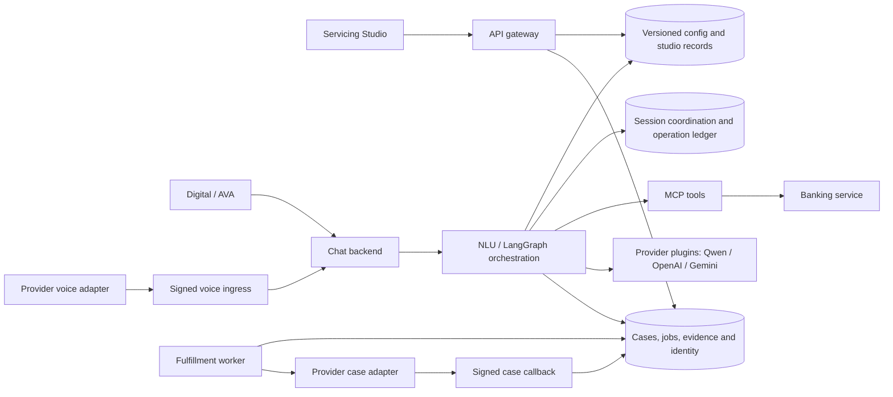

# Customer servicing control plane

The app now includes **Servicing Studio** at `/control-plane` for a dedicated
enterprise deployment across Digital, AVA and a provider-neutral IVR adapter.
It extends the established gateway → chat → NLU/LangGraph → MCP → banking
architecture. It does not introduce a second conversation or financial execution
engine.

Read the [implementation and market-gap matrix](servicing-product-implementation.md),
[API reference](../../services/api-gateway/control-plane/README.md),
[adapter and operations runbook](servicing-operations.md),
[model providers and remote Qwen setup](llm-providers.md),
[runtime reference](../../services/ai-orchestrator/CONTROL-PLANE-RUNTIME.md), and
[console guide](../../services/frontend/OPERATIONS-CONSOLE.md).

## What operators can change

| Area | Configurable behavior |
| --- | --- |
| Channels | Enablement, automated/human mode, queue, timeout policy |
| Intents | Existing 16 banking intents and custom aliases, case/service intents and knowledge intents; examples, required/optional fields, typed field constraints, tool subset, confirmation requirement |
| Prompts | Each intent's system and user template, extraction instructions, clarification/data-collection/handoff/unavailable wording and confirmation introduction |
| Recognition | Lexical, external provider or governed LLM; recognition instructions, confidence threshold, ambiguity margin/action and synonyms |
| Models | Provider/model profiles, generation/extraction/recognition task routes, generation override per intent, temperature, output limit and deadline |
| Journeys | Intent membership, channel availability, automated/human fulfillment, queue, SLA |
| Quality | Utterance and multi-turn contract suites, expected intent/action/tools/fields and exact-content publish gates |
| Releases | Drafts, semantic diff, independent approvals, immutable versions, environment promotion, canary percentage and outcome-based rollback thresholds |
| Knowledge | Text documents, sources, role permissions, expiry, draft/publish/archive, connector import and revision history |
| Connections | Case/voice/knowledge adapters, approved host, secret reference, deadline, enablement and real health test |
| Operations | Case reconciliation, transaction exception resolution, voice recovery, evidence export, retention and subject privacy operations |
| Identity | Trusted issuer/subject mapping to local customer/operator identities and signed roles |

Financial tool contracts, minimum required fields, ownership checks and mandatory
transaction confirmation remain code-enforced safety boundaries. Prompt edits do
not change authoritative balances, invent successful actions, introduce arbitrary
code execution, or remove mandatory confirmation. A new banking capability still
requires an implemented, registered domain tool. Custom `service_request` and
`knowledge_search` intents can be authored without adding banking tools.

## Architecture



The control plane selects a published release using the authenticated principal
and server environment. Active workflows pin that release and preserve it across
later turns and authenticated channel handoffs. A draft never changes runtime
behavior. Required evaluation/approval gates apply to the exact configuration and
current suite fingerprints.

## Start a dedicated deployment

1. Use Node.js 22+, PostgreSQL and Redis with the existing service deployment.
   Apply banking migrations including `V9__control_plane_roles.sql`.
2. Set `DEPLOYMENT_TENANT_ID` consistently across services and use the same secure
   local access-token signing key. Set a **different** `SERVICING_SERVICE_TOKEN`
   on the gateway, orchestrator and chat service.
3. Set `CONTROL_PLANE_ENABLED=true`, `CONTROL_PLANE_DATABASE_URL`, and
   `OPERATIONS_DATABASE_URL` (defaults to the control-plane URL, then `DATABASE_URL`).
   Point `CONTROL_PLANE_URL` and `OPERATIONS_URL` at the gateway's internal URLs.
4. Enable `WORKFLOW_DURABLE_EXECUTION=true` and `HANDOFF_STORAGE=postgres`.
   `WORKFLOW_DATABASE_URL` and `HANDOFF_DATABASE_URL` can override the existing
   per-service database settings. Use `CONTROL_PLANE_ENVIRONMENT=production` for
   production runtime selection; promote a tested release to production.
5. Enable `FULFILLMENT_WORKER_ENABLED=true`. The worker dispatches configured
   cases, checks SLA timers, recovers uncertain leases and observes canary
   outcomes. No configured provider leaves cases visibly queued.
6. Give an initial local administrator a signed `control_plane_admin` role using
   the banking role migration/administration process. Sign in again after a role
   change. Open Servicing Studio, configure enterprise identity and map subjects.
7. Register provider adapters and secret references, run health/contract tests,
   author suites, publish knowledge, enable release gates, and promote the
   reviewed version. IVR starts disabled and must be explicitly enabled after
   the voice adapter is qualified.
8. Configure the server model registry and the separate Mac Studio address.
   Discover its installed Qwen tag, run the explicit synthetic smoke tests, then
   enable and publish the chosen model profiles. The starter profile is disabled
   until configured. See the [model setup guide](llm-providers.md).

Docker examples pass the new runtime/database settings. They are deployment
examples, not hardened production secret stores. Mount provider credentials from
your secret manager or explicitly pass named `CONNECTOR_SECRET_*` variables to
the gateway. Merely defining a host-shell variable does not inject it into a
container. See [operations setup](servicing-operations.md).

## Authorization

| Signed role | Access |
| --- | --- |
| `control_plane_admin` / `admin` | Configure, approve, publish, promote, connect providers, map enterprise identities, privacy and evidence administration |
| `control_plane_editor` | Edit drafts, suites and knowledge drafts; run evaluations |
| `control_plane_operator` | View operational work and reconcile cases; scoped runtime access for context and financial exceptions |
| `control_plane_viewer` | Read control-plane configuration and operational summaries |
| Customer | Published runtime policy and authorized knowledge, own conversations and one-time handoffs |

Enterprise mappings issue five-minute local access tokens. Operator mappings
receive `servicing:context:read`, `servicing:operations:read` and
`servicing:operations:reconcile`; administrators receive `*`. Locally issued
operator tokens must explicitly include these scopes for runtime exception APIs.
Changing/disablement of a mapping affects session refresh immediately; an already
issued access token remains valid until its short expiry.

No unverified browser role, request-body principal, phone number, caller-supplied
cohort or IdP group string grants administrative access. Runtime case/evidence
writes require both a customer access token and the internal service token.

## Operating boundaries

- Provider-neutral voice supports signed speech-text/DTMF events, interruption,
  authenticated session creation/resume, speak/gather/transfer/end actions and
  replay protection. The telephony adapter supplies media, speech recognition,
  TTS, call control and the actual contact-center transfer.
- Contract evaluations never call financial tools or live providers. They test
  governed recognition/routing/field/tool contracts. Provider sandbox, acoustic,
  generative response and customer acceptance tests remain separate.
- Lexical recognition is a deterministic fallback, not an embedding model.
  External or model-based recognition requires a configured provider and calibrated
  evaluation data. The simulator labels its fallback behavior.
- Unknown external outcomes are held for reconciliation. There is no blind
  retry of a possibly completed financial operation. Case retry requires the
  provider's authoritative idempotency lookup.
- Event chains provide tamper evidence, not immutable storage against a database
  administrator. Sign exports and archive them in customer-controlled immutable
  storage. Back up configuration, operational and runtime databases together.
- New studio/operational data is normalized and paginated. Legacy control-plane
  release/audit/manual-work history remains in its original configuration
  aggregate, with bounded API responses. Large installations should archive or
  migrate that legacy history; no unbounded-scale claim is made.
- This release targets dedicated enterprise deployment. Shared SaaS tenancy,
  tenant billing and a complete workforce/contact-center product are outside
  this deployment model.

## Verification

Run `npm test` for gateway, orchestrator, chat, banking, NLU and frontend, then
`npm run build -w services/frontend`. Use disposable databases for integration
checks:

```bash
TEST_CONTROL_PLANE_DATABASE_URL=... TEST_OPERATIONS_DATABASE_URL=... \
  npm test -w services/api-gateway -- --runInBand
RUNTIME_TEST_DATABASE_URL=... npm test -w services/ai-orchestrator -- --runInBand
RUNTIME_TEST_DATABASE_URL=... npm test -w services/chat-backend -- --runInBand
```

Database tests cover replica conflicts, durable operation replay, unknown
outcomes, one-time handoffs, signed callbacks, field/permission boundaries,
knowledge filtering, retention tombstones and evidence-chain verification. CI
runs these against disposable PostgreSQL, not production data.
