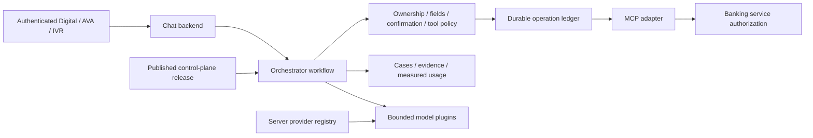

# Orchestrator architecture

A new workflow saves a published snapshot before action. Continuations retain it. The snapshot selects intent, channel, journey, tools, prompts, field rules, recognition, and model profiles; credentials/endpoints stay server owned. Models never dispatch banking tools.

PostgreSQL sessions retain the pending workflow. A separate PostgreSQL advisory lock serializes turns and the mutation ledger prevents duplicate dispatch across retries. LangGraph `MemorySaver` is process-local graph state, not a durable checkpoint service. Uncertain actions require operator reconciliation.

The [runtime contract](CONTROL-PLANE-RUNTIME.md) is authoritative for routing, custom intents, handoff, model availability, evidence, persistence, and failure behavior. [Routes](src/routes/orchestrator.routes.js), [workflow](src/workflows/bankingChatWorkflow.js), [runtime persistence](src/services/runtimePersistence.js), and the [provider contract](src/llm/README.md) are implementation references.
