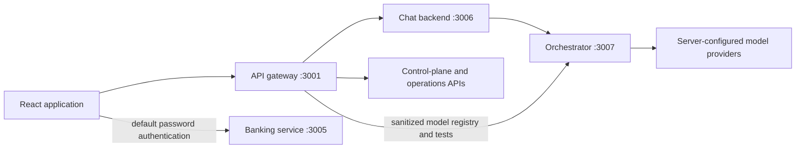

# Frontend architecture

This describes the current implementation. See the
[documentation index](../../docs/README.md) for system architecture and
[operator guide](OPERATIONS-CONSOLE.md) for console flows.

## Bootstrap and routing

[main.tsx](src/main.tsx) fetches runtime configuration before dynamically importing
[App.tsx](src/App.tsx). This ensures clients read deployment-specific endpoints
and tenant storage names on construction. `BrowserRouter` exposes `/auth`, `/chat`,
and `/control-plane`; protected routes use the authentication store. Unknown paths
redirect according to authentication state. The web host must support SPA fallback.

The configured authentication base may be deployed behind a gateway instead of the
local direct-bank default. Enterprise identity uses gateway identity routes and
an HttpOnly server session. This diagram does not imply direct browser access to
banking tools, provider credentials, or model hosts.

## Authentication boundary

[authService.ts](src/services/authService.ts) stores access tokens and normalized
profiles in tenant-prefixed browser storage. Password login also stores the
returned refresh token. Enterprise session handoff clears a previous password
refresh token and uses credentialed session refresh instead. Sign-out clears local
authentication and requests enterprise-session invalidation where applicable.

[authStore.ts](src/stores/authStore.ts) supplies authentication state to the route
guard and header. A servicing-role check controls the studio navigation link;
the gateway independently verifies tokens, roles, tenant binding, and scopes.
Browser role labels are never the authorization authority.

## Customer chat and sessions

[api.ts](src/services/api.ts) creates one canonical backend session, sharing an
in-flight creation promise. Chat messages use that session ID. Starting a new
conversation requests deletion of the prior backend session before creating a new
one; failure to delete an expired session does not block creation.

[useChat.tsx](src/hooks/useChat.tsx) manages conversation UI state and normalizes
history responses. The current transport sends complete HTTP requests and receives
complete responses; it does not stream tokens. Axios attaches access/session/request
headers and retries a rejected 401 once after successful authentication refresh.
An unrecoverable authentication failure updates the store through `auth:logout`.

`sendMessage` uses the runtime `chatRequestTimeoutMs` budget, default 420,000 ms,
to accommodate multiple model stages. Other calls keep the client default of
30 seconds. Timeout does not itself establish that a backend mutation was cancelled;
uncertain operation outcomes belong in the server reconciliation workflow.

## Servicing Studio

[ControlPlanePage.tsx](src/pages/ControlPlanePage.tsx) owns the local draft and
loaded server state. [Typed configuration](src/types/controlPlane.ts) includes
channels, intents, prompts, journeys, queues, recognition, and model profiles.
The advanced JSON editor exposes the complete configuration contract.

Focused modules in [components/control-plane](src/components/control-plane)
provide model discovery, evaluations, knowledge, connections, operations, release
comparison, and governance. Local form edits use React state; persisted resources
use server revisions. Save local configuration changes before studio mutations;
save a module form before leaving that module. A conflict preserves local edits
and requires reconciliation with the latest server revision.

[controlPlaneService.ts](src/services/controlPlaneService.ts) authenticates gateway
requests, reports structured errors, refreshes authentication once for a 401, and
rejects successful responses containing HTML instead of API JSON. It does not
retry ambiguous network failures. Publication and environment promotion remain
separate server-controlled operations; the browser never executes a release.

## Models, evaluation, and provider boundaries

Model profiles are draft configuration. Provider URLs, credentials, allowlists,
and adapter implementations are server-owned. The browser sees only a sanitized
registry and can request discovery or a fixed synthetic test according to role.
An unavailable provider is displayed as unavailable, without implicit cloud fallback.

Per-intent model overrides affect generation; extraction and recognition use their
shared routes. Model-based recognition also requires its recognition policy.
Contract simulation reports configured profile references but does not run models
or judge generated quality. Knowledge retrieval respects server-authorized roles,
publication status, and expiry. See [LLM providers](../../docs/guides/llm-providers.md)
and [control-plane contract](../../docs/guides/control-plane.md).

## Structure and verification

The application retains atoms/molecules/organisms for chat UI, page components for
routes, and dedicated control-plane components. Styles are regular CSS imports.
Authentication uses Zustand; chat and console editing use hooks/component state.

The [package scripts](package.json) provide typecheck, ESLint, Vitest, and production
build checks. Unit tests verify authentication, request contracts, conflicts,
structured errors, and timeout bounds. Live integration, model quality, recovery,
capacity, and deployment readiness require separate evidence; historical completion
reports do not establish those properties.
