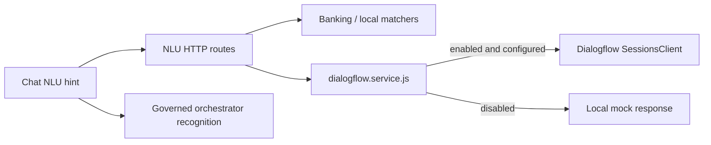

# Dialogflow SDK placement

The active wrapper is [dialogflow.service.js](src/services/dialogflow.service.js). `dialogflow-enhanced.service.js` explores wider SDK capabilities and is not wired into the mounted runtime. SDK management features shown in historical reports therefore do not constitute supported runtime APIs. Runtime training remains explicitly unsupported.

The orchestrator's server model registry and published recognition profiles are separate from this legacy hint service. See [current architecture](ARCHITECTURE.md), [integration settings](DIALOGFLOW-INTEGRATION-GUIDE.md), and [governed runtime](../ai-orchestrator/CONTROL-PLANE-RUNTIME.md).
